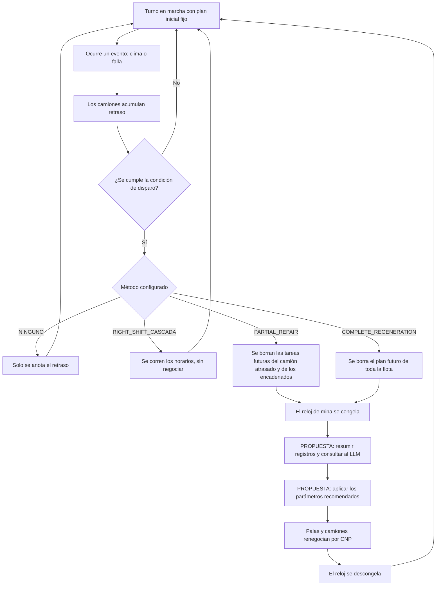

# Flujo de episodios y punto de entrada del LLM

Documento de trabajo para explicar al equipo y al profesor cómo reacciona el
sistema ante los retrasos, en qué momento entraría el LLM, qué hay que revisar
en el código y qué decisiones están abiertas.

Estado: 16 de noviembre de 2026. Lo marcado como **propuesta** todavía no está
decidido ni implementado.

---

## 1. La idea en simple

1. Al empezar el turno, cada camión tiene un horario: a qué hora carga en qué
   pala y a qué hora descarga.
2. Durante el turno ocurren eventos (lluvia, neblina, tormenta, fallas de
   camión, pala o chancador) y los camiones empiezan a llegar tarde.
3. Un agente vigilante (`ReschedulingAgent`) revisa cada 2 minutos de mina
   cuánto atraso lleva cada camión.
4. Cuando el atraso supera un umbral, el horario ya no sirve y hay que
   arreglarlo. Ese momento se llama **episodio de reprogramación**.
5. Según el método configurado, arreglar el horario implica o no que palas y
   camiones vuelvan a negociar.
6. **Propuesta:** el LLM entra justo antes de esa negociación y recomienda con
   qué parámetros negociar.

## 2. El flujo

Los pasos K y L son lo que falta construir. Todo lo demás ya existe.

## 3. Los casos

### 3.1 Qué hace cada método

El método se elige antes de la corrida (constante `METODO_RESCHEDULING` en
`src/ParametrosSimulador.java`) y queda fijo todo el turno.

| Método | Qué hace | ¿Renegocia? | ¿Entra el LLM? |
|---|---|---|---|
| `NINGUNO` | Anota el retraso y sigue con el plan original | No | No |
| `RIGHT_SHIFT_CASCADA` | Corre más tarde las tareas del atrasado y de los que chocan con él | No | No con parámetros de negociación |
| `PARTIAL_REPAIR` | Borra y renegocia lo que le quedaba al camión atrasado y a los encadenados | Sí, parcial | Sí |
| `COMPLETE_REGENERATION` | Borra y renegocia el plan futuro de toda la flota | Sí, total | Sí |

### 3.2 Cuándo se dispara un episodio

| Método | Condición |
|---|---|
| `PARTIAL_REPAIR` y `RIGHT_SHIFT_CASCADA` | Un camión supera 25 min de retraso. Para el mismo camión solo se vuelve a disparar si el retraso crece 15 min más |
| `COMPLETE_REGENERATION` | El 25 % de la flota (mínimo 4 camiones) supera 25 min a la vez, **o** un solo camión llega a 45 min. Frenos: 30 min de mina entre regeneraciones y máximo 3 por turno |

### 3.3 Casos en que el LLM no actúa

- El método es `NINGUNO`: nunca hay episodios.
- El método es `RIGHT_SHIFT_CASCADA`: hay episodios pero no negocian.
- Turno tranquilo: ningún camión cruza el umbral.
- Inicio del turno: con plan inicial fijo no se negocia el plan de partida.

### 3.4 Caso especial: el primer episodio

En el primer episodio del turno todavía no hubo negociaciones, así que el LLM
no tiene historial del turno en curso. Tendría que apoyarse en los parámetros
de la corrida, los eventos, los retrasos observados y, eventualmente, registros
de corridas anteriores.

## 4. Qué pasa dentro de una renegociación

1. Una pala con un hueco libre pregunta a todos los camiones: "tengo carga a
   tal hora, ¿quién puede?".
2. Cada camión responde que sí (con su hora de llegada) o que no.
3. La pala elige la mejor propuesta, o se queda sin nadie.
4. Si nadie pudo, la pala avanza su oferta 60 segundos de mina y vuelve a
   preguntar.

`DEADLINE_MS` es el plazo que la pala da para responder (hoy 5.000 ms).
Los camiones no responden apenas saben: esperan hasta que falten 2 segundos
para el plazo, para poder comparar ofertas de varias palas. Por eso cada
pregunta tarda cerca de 4 segundos reales, haya o no interesados.

- **Más plazo:** el camión compara más ofertas, pero cada pregunta tarda más.
- **Menos plazo:** todo va más rápido, pero el camión decide viendo menos ofertas.

### 4.1 Parámetros candidatos para el LLM

`DEADLINE_MS` no es el único. Hay tres grupos, según qué controlan.

**A. A quién se le asigna la carga (pesos de selección).** Cuando varios
camiones proponen, la pala calcula un costo para cada uno y elige el menor
(`ShovelAgent.java:647-651`):

| Peso | Valor hoy | Qué castiga o premia |
|---|---|---|
| `W_ESPERA_PALA` | 2,0 | Que la pala quede esperando al camión |
| `W_VIAJE_VACIO` | 1,0 | Viaje vacío largo hasta la pala |
| `W_VIAJE_CARGADO` | 1,0 | Viaje cargado largo hasta el destino |
| `W_ESPERA_DESCARGA` | 1,5 | Cola en el punto de descarga |
| `W_CAPACIDAD` | 1000 | Premia camiones de mayor capacidad |

Ejemplo de recomendación: si los KPIs muestran mucha cola en el chancador,
subir `W_ESPERA_DESCARGA`.

**B. Cuánto dura y cuesta la negociación.**

| Parámetro | Valor hoy | Dónde |
|---|---|---|
| `DEADLINE_MS` | 5.000 ms | `ParametrosConfiguracion` |
| Margen de respuesta del camión | 2.000 ms antes del plazo | `TruckAgent.java:231` |
| Paso del barrido de re-oferta | 60 s de mina por intento | `ShovelAgent` |
| Ticker de la pala | 2 s reales | `ShovelAgent.java:115` |

**C. Cuándo se repara (cuántos episodios hay).**

| Parámetro | Valor hoy |
|---|---|
| Umbral de retraso para disparar | 25 min |
| Retraso adicional para re-disparar | 15 min |
| Umbral individual para regenerar todo | 45 min |
| Fracción de flota para regenerar todo | 25 % |
| Enfriamiento entre regeneraciones | 30 min de mina |
| Máximo de regeneraciones por turno | 3 |

A tener en cuenta:

- **Solo `DEADLINE_MS` se puede cambiar hoy sin recompilar.** El resto son
  constantes fijas; los pesos están declarados dentro del método. Para
  modificarlos en caliente hay que tocar los agentes.
- **Los pesos casi no se ejercitaron en los datos disponibles.** De las 3.170
  negociaciones de `pequeno_PARTIAL_REPAIR_r1`, solo 21 tuvieron más de una
  propuesta entre las que elegir. Pesarían más en `COMPLETE_REGENERATION` o al
  negociar el plan inicial, donde muchos camiones están libres a la vez.
- **El grupo C decide cuándo se negocia, no cómo.** Si cuenta como "parámetros
  de negociación" es pregunta para el profesor.
- **El ticker y el margen de 2 s** son más detalles de implementación que
  decisiones operativas; se sugiere dejarlos fuera.

Orden sugerido de candidatos, de más a menos defendible: `DEADLINE_MS`, los
cinco pesos, el paso del barrido y, si el profesor lo acepta, los umbrales de
disparo.

## 5. Lo que muestran los datos

Corrida `pequeno_PARTIAL_REPAIR_r1` (interrumpida, sirve solo como ejemplo):

| Dato | Valor |
|---|---|
| Episodios | 4 |
| Camiones liberados por episodio | 6, 1, 7 y 13 |
| Negociaciones | 3.170 |
| Negociaciones con ganador | 70 (2,2 %) |
| Negociaciones sin ninguna propuesta | 3.096 |
| Mensajes registrados | 159.634 |
| Duración real de cada episodio | cerca de 14 min |
| Duración real total | cerca de 52 min, para unos 10 min de mina |

Lectura:

- En cada episodio las **5 palas** recorren todo lo que queda del turno, aunque
  solo una (PA03) tenía huecos. Las otras cuatro suman 3.022 de los 3.096 fallos.
- Los 15 camiones respondieron siempre. Los rechazos fueron por "camión ocupado"
  (13 camiones) o "ruta inexistente" (2 camiones), no por falta de plazo.
- El costo de un episodio es casi proporcional a `DEADLINE_MS`: unos 205
  intentos por pala a 4 segundos cada uno.

## 6. Cosas que ver o corregir en el código

| # | Tema | Dónde | Estado |
|---|---|---|---|
| 1 | Barrido de re-oferta en las 5 palas, no solo en la afectada | `ShovelAgent` (`iniciarBarrido`), `ReschedulingAgent` | Por decidir si es esperado o se corrige |
| 2 | Truck2 y Truck7 sin ruta: parten en `#RF11` y `#BOT`, vértices aislados del grafo | `datosShovelTrucksPequeno.owl`, `points_20032019.owl` | La flota Pequeño opera con 13 de 15 camiones |
| 3 | Comparación de `conversationId` con `==` | `ShovelAgent.java:525` y `:552` | No falla hoy; riesgo si los agentes corren en JVM distintas |
| 4 | Encabezado invertido en `negotiations.csv` (rotula refuses/proposes al revés) | `CsvNegotiationsLogger` | El preprocesador lo corrige al leer; el archivo sigue mal rotulado |
| 5 | Parámetros que no se pueden cambiar en caliente | `ReschedulingAgent` (umbrales), `ShovelAgent` (pesos de selección y paso de 60 s), `TruckAgent` (margen de 2 s) | Son constantes fijas al compilar; `DEADLINE_MS` sí se puede cambiar |
| 6 | Punto de consulta al LLM al inicio del episodio | `ReschedulingAgent` / `EpisodioRescheduling` | No existe |
| 7 | Orden de filas no determinista en `plan_original.csv` y `ejecucion_real.csv` | Escritura de resultados | Mismas filas, distinto orden entre corridas idénticas |
| 8 | Columna `trigger` de `liberaciones.csv` trae el camión liberado, no el disparador | `CsvLiberaciones` | El preprocesador toma el disparador de otra fuente |

Sin probar todavía:

- El preprocesador con `COMPLETE_REGENERATION`, con cascadas y con hora
  simulada cuando hay episodios.
- La columna `t_sim_ms` en `negotiations.csv` (las corridas `NINGUNO` no negocian).
- El efecto de otros valores de `DEADLINE_MS`: solo hay datos con 5.000 ms.

## 7. Decisiones por tomar

| Decisión | Opciones | Sugerencia |
|---|---|---|
| Cuándo actúa el LLM | En cada episodio / entre turnos | En cada episodio: calza con H1 y con medir el tiempo de respuesta |
| Qué puede recomendar (ver 4.1) | Solo `DEADLINE_MS` / también pesos de selección, paso del barrido y umbrales de disparo | Partir con `DEADLINE_MS` y los cinco pesos; sumar el resto si hay tiempo |
| Qué historial recibe | Solo el turno en curso / también corridas anteriores | Ambos, cuidando que el historial no sea del mismo escenario que se evalúa |
| Elegir el método con el LLM | Sí / no | No por ahora: dejarlo como trabajo futuro |
| Barrido de las 5 palas | Corregir / dejar | Decidir antes de evaluar, porque cambia la línea base |
| Camiones sin ruta | Corregir el escenario / declarar limitación | Declarar limitación, salvo que el profesor pida corregir |

## 8. Para debatir con el profesor

1. **¿El LLM recomienda en cada episodio de reprogramación o entre turnos?**
   La hipótesis H1 habla de tiempos compatibles con la decisión operativa y el
   documento mide el tiempo de respuesta del LLM, lo que apunta a "en cada
   episodio"; pero la metodología lo deja como decisión de diseño.
2. **¿Qué parámetros cuentan como "parámetros de negociación"?** El plazo y
   los pesos de selección parecen claros; la duda son los umbrales que deciden
   cuándo se repara (grupo C de la sección 4.1).
3. **¿Se pueden acortar las corridas?** Una `PARTIAL_REPAIR` en Pequeño toma
   cerca de una hora y la evaluación pide varias repeticiones por método y
   tamaño. Opción: bajar `DEADLINE_MS` y los tickers en ambos brazos.
4. **¿El barrido de re-oferta en todas las palas es el comportamiento esperado?**
   Es el 95 % del costo de cada episodio.
5. **¿La elección del método queda como trabajo futuro?**
6. **¿Qué escenarios y cuántas repeticiones** se exigen para contrastar H1?
7. **¿Cómo evitar que el LLM "ya conozca" el escenario?** Las corridas son casi
   deterministas (misma semilla y mismos eventos).

## 9. Para debatir con el equipo

- Qué modelo se usa y con qué configuración (hay que documentarlo para
  reproducibilidad).
- Formato de la recomendación: parámetro, valor y motivo.
- Quién corre qué y en qué máquina: las corridas que se comparan no deben
  mezclarse entre equipos distintos.
- Convención de etiquetas: una etiqueta única por corrida, por ejemplo
  `pequeno_PARTIAL_REPAIR_r2`.

## 10. Avance contra los objetivos

| Objetivo específico | Estado |
|---|---|
| 1. Estado del arte y análisis del sistema | Análisis del sistema avanzado |
| 2. Preprocesamiento de registros y diseño de la interacción | Preprocesador listo (`preprocesar_registros.py`); falta el prompt y el formato de salida |
| 3. Criterios y métricas | Sin empezar |
| 4. Implementación del componente | Sin empezar |
| 5. Evaluación con y sin el componente | Sin empezar |

Próximos pasos que no dependen de las decisiones de arriba:

1. Commit del preprocesador.
2. Una corrida `PARTIAL_REPAIR` completa con etiqueta única y su manifest.
3. Bosquejo del prompt y del formato de la recomendación.

## Glosario

- **Episodio:** cada vez que el sistema decide reparar el horario.
- **Negociación (CNP):** una pregunta de una pala a los camiones y sus respuestas.
- **Barrido de re-oferta:** la pala recorre el turno restante ofreciendo horas de a 60 s.
- **Tiempo real:** el del reloj del computador. **Tiempo de mina (simulado):** el del turno, que corre a 100x y se congela durante un episodio.
- **`DEADLINE_MS`:** plazo que la pala da a los camiones para responder.
